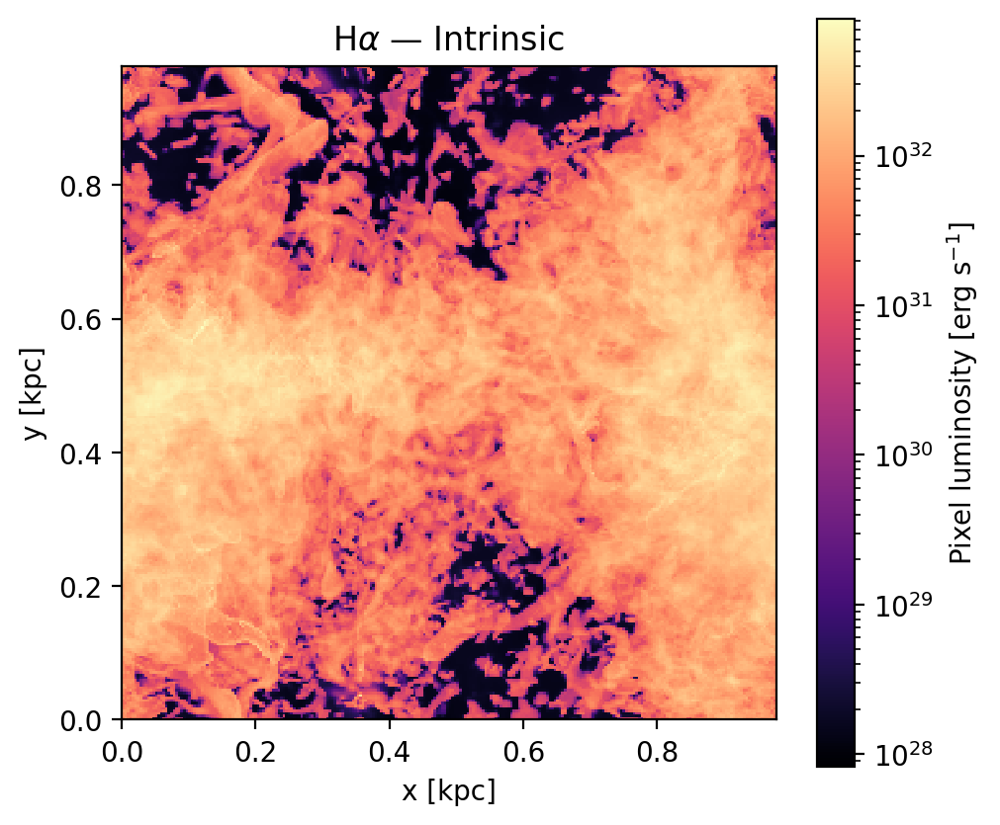
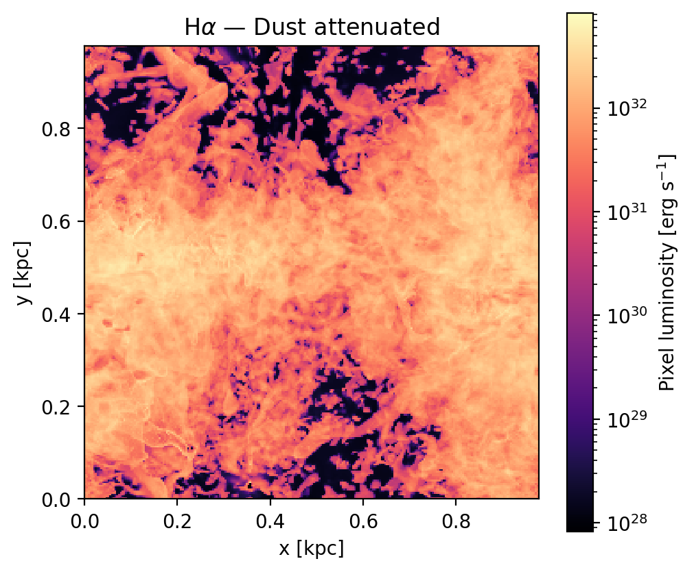
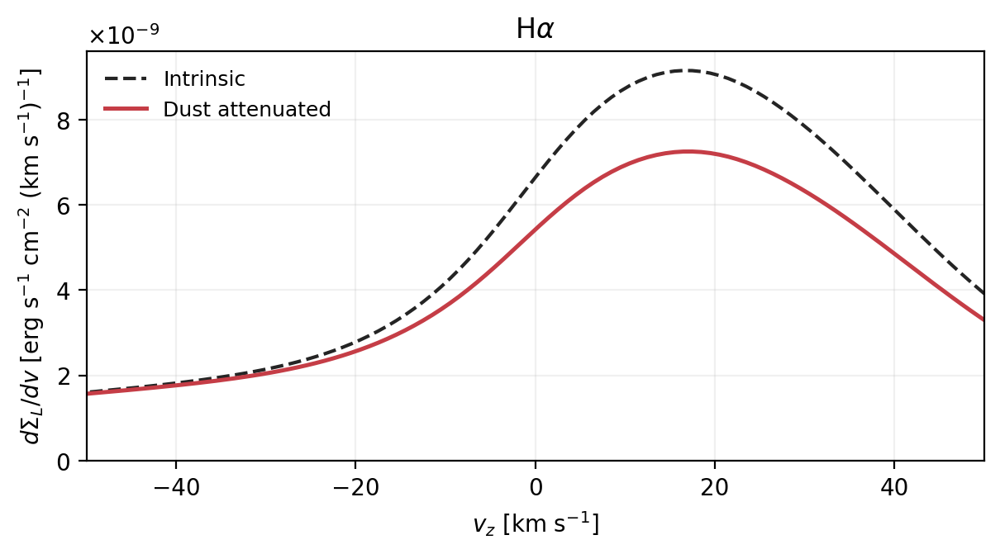

# quokka2s — QUOKKA emission post-processing

Running on Setonix? Follow the [Setonix guide](docs/setonix.md) to configure
the environment, process a snapshot, and plot on Setonix or locally.

## 1. Clone

```bash
git clone --branch codex/cloudy-emission-backup https://github.com/bcTiann/quokka_postprocess_3D.git
cd quokka_postprocess_3D
```

## 2. Configure the environment

With [uv](https://docs.astral.sh/uv/getting-started/installation/) installed,
create a Python 3.11 environment from the repository root. This is the Python
version used to validate the pipeline:

```bash
uv venv --python 3.11
source .venv/bin/activate
uv pip install -r requirements.txt
export PYTHONPATH="$PWD/src${PYTHONPATH:+:$PYTHONPATH}"
```

`pyproject.toml` is the maintained list of direct dependencies;
`requirements.txt` is its generated processing lock, including the tested yt
source commit and transitive dependencies. The project itself is not installed:
Python loads the checkout's `src/` through `PYTHONPATH`. The first yt source
build needs Git and C/C++ build tools; uv can reuse its cached build afterward.

For later terminal sessions, return to the repository root and run only:

```bash
source .venv/bin/activate
export PYTHONPATH="$PWD/src${PYTHONPATH:+:$PYTHONPATH}"
```

Repeat `uv pip install -r requirements.txt` when the dependency lock changes.
Source-code changes are used directly on the next run. For a smaller environment
that only plots saved products, and for lock regeneration, see
[dependency setup and maintenance](docs/usage.md#source-environment-and-dependencies).

## 3. Set the inputs

The supplied configuration uses these input paths, relative to the repository
root. The snapshot and outputs can also be stored outside the repository.

| Input | Default path | Provided by |
|---|---|---|
| Simulation snapshot | `inputs/snapshots/plt0655228/` | The user |
| DESPOTIC table | `inputs/tables/despotic/interpolated.npz` | Included in Git |
| Cloudy table | `inputs/tables/cloudy/emission.npz` | Included in Git |

Edit the first three settings in [configs/emission.yaml](configs/emission.yaml):

```yaml
jobname: sigma13.v2
dataset: ../inputs/snapshots/plt0655228
results_dir: ../output
```

`jobname` identifies the simulation setup. `dataset` points to the complete
snapshot directory containing `Header`, `metadata.yaml`, and its data
subdirectories. The snapshot name is taken from this path, here `plt0655228`.
Process saves numerical results in
`results_dir/jobname/snapshot_name/processed/`; plot reads that same directory.
If either x/y index range is set, both commands instead select an automatically
named region folder, for example
`results_dir/jobname/snapshot_name/region_x64-66_y64-66/processed/`.
An omitted or `null` axis uses `all` in the name. Keep `results_dir` unchanged
when selecting a region; see [region settings](docs/usage.md#select-an-x-y-region).
Relative YAML paths are relative to the configuration file; absolute paths
are also supported. The two bundled tables are used by default.

On Setonix, keep the repository and bundled tables under `$MYSOFTWARE`, and
store the snapshot and processed results under `$MYSCRATCH`. Use the
[Setonix input settings](docs/setonix.md#3-set-the-inputs)
to set these paths in `configs/emission.yaml`.

The bundled tables are for the `plt0655228` reference snapshot.
Snapshot grid dimensions are read from the data; processing supports
three-dimensional uniform level-0 grids at other resolutions too. A full
`512 × 512 × 4096` grid produces native `512 × 512` luminosity images.
For another snapshot, [check its table-input ranges](docs/usage.md#check-table-input-ranges)
before processing; grid support does not imply that the bundled axes cover it.

## 4. Process

Run from the repository root:

```bash
python src/quokka2s/process_snapshot.py
```

Both commands read [configs/emission.yaml](configs/emission.yaml).
Use `--config /path/to/emission.yaml` with either command to select another file.
Default numerical results: `output/sigma13.v2/plt0655228/processed/`.
For another snapshot, change `dataset`; for another simulation setup, also
change `jobname`. Processing does not overwrite an existing result directory.

## 5. Plot

```bash
python src/quokka2s/plot_emission_results.py
```

Plot selects the saved snapshot using `results_dir`, `jobname`, and the
snapshot name from `dataset`, together with any x/y index ranges. It does not
open the snapshot or emission tables.
To plot an earlier result, select its job and snapshot and the corresponding
x/y ranges; omit the ranges for a full-box result.
Process saves the numerical arrays, normalization and colour limits; plot
reads them to draw. Optional image-resolution preparation is described in
the [usage guide](docs/usage.md#plot-settings).

Figures: `output/sigma13.v2/plt0655228/figures/` and
`output/sigma13.v2/plt0655228/figures_titled/`, each with `png/` and `pdf/`
subdirectories. The default `titled_figures: true` writes both versions.

Different jobs can have snapshots with the same name:

```text
output/
├── sigma13.v2/
│   ├── plt0655228/
│   │   ├── processed/
│   │   ├── figures/
│   │   ├── figures_titled/
│   │   └── region_x64-66_y64-66/
│   │       ├── processed/
│   │       ├── figures/
│   │       └── figures_titled/
│   └── plt0916720/
└── sigma50/
    └── plt0655228/
```

## Example outputs

Hα luminosity images for the complete `plt0655228` snapshot, viewed along
the z axis. Both images use the same colour scale.

| Intrinsic | Dust attenuated |
|---|---|
|  |  |

Integrated Hα spectrum before and after dust attenuation:



## Repository structure

```text
configs/       Process and plot settings
src/quokka2s/  Snapshot reading, emission calculations and plotting
inputs/        Simulation snapshots and lookup tables
output/        Processed data and generated figures
tools/         Table-building tools and additional figures
vendor/        External code and reference data
docs/          Usage, methods, code guide and example images
```

[Detailed usage](docs/usage.md) · [Methods](docs/emission_method.md) ·
[Code guide](docs/code_walkthrough.md)
